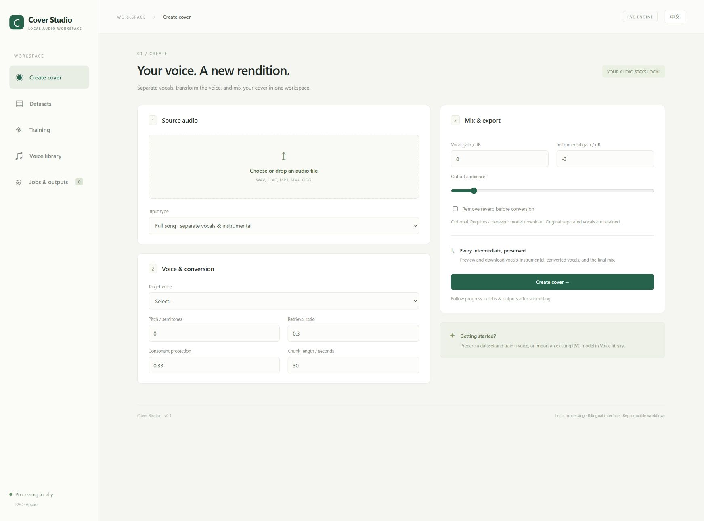

# Cover Studio

English · [简体中文](README.md)

A local bilingual workstation for AI covers using RVC / Applio. Designed with Chinese singing in mind. Switch between Chinese and English in the upper-right corner; the browser remembers your preference.



## Features

- Vocal/instrumental separation, optional dereverb, slicing, quiet/clipping flags and manual clip review.
- RVC preprocessing, RMVPE F0 extraction, ContentVec features, training and retrieval-index orchestration.
- Import `.pth` checkpoints and optional `.index` files; export portable voice ZIP bundles.
- Full-song or dry-vocal conversion, pitch shift, retrieval ratio, protection and contextual overlap stitching.
- Vocal/instrumental gains, simple ambience, peak-limited mixing, intermediate downloads and 24-bit WAV output.
- Persistent local jobs, logs, stop/retry, validated completed-stage caches and manual recovery after restart.

**No personal voice training or real-song conversion has been performed, as requested by the user.** Synthetic-signal and identity-converter tests verify plumbing and stitching, not audio quality. See [implementation status](docs/IMPLEMENTATION_STATUS.md) for measured validation.

## Windows setup

Requirements: Python 3.12 available as `py -3.12`, Git, and an NVIDIA GPU with a compatible driver. Initial setup needs internet access and approximately 20–30 GB of disk space. Other platforms are not validated.

1. Clone this repository.
2. Run `install.bat` to install the three environments, pinned Applio checkout and base RVC models.
3. Run `start.bat` and open `http://127.0.0.1:7860`.

Component installation:

```powershell
powershell -NoProfile -ExecutionPolicy Bypass -File scripts/setup.ps1
powershell -NoProfile -ExecutionPolicy Bypass -File scripts/setup.ps1 -Engine
powershell -NoProfile -ExecutionPolicy Bypass -File scripts/setup.ps1 -Separator
powershell -NoProfile -ExecutionPolicy Bypass -File scripts/setup.ps1 -Models
```

Use `-All` for everything. The UI uses `.venv`; RVC uses `.venv-rvc`; separation uses `.venv-separator`. GPU environments install PyTorch 2.11.0 CUDA 13.0 wheels first. Run `.venv/Scripts/python scripts/doctor.py` to check imports, CUDA matrix operations and upstream revision without training. Results are saved in `data/diagnostics.json`.

## Workflow

1. Upload target recordings in **Datasets**. Separate vocals when recordings contain accompaniment; enable dereverb/high-pass only when needed.
2. After preparation, review clips and save your selection. Very quiet clips are excluded by default.
3. Select a dataset in **Training** and start explicitly. The job runs preprocessing, feature extraction, base-weight verification/download, training and indexing.
4. The latest inference checkpoint is registered in **Voice library**. Other exported checkpoints are available in job outputs; download and reimport them to compare.
5. Upload a song in **Create cover**, choose a voice, and submit. Dry vocals can skip separation and optionally use a separately uploaded instrumental. Preview/download outputs in **Jobs & outputs**.

Existing RVC users can import `.pth` / `.index` directly. Exported voice ZIPs contain a model, optional index and manifest; unzip them before importing files on another machine.

BS-RoFormer is the default separator. Optional dereverb uses `MDX23C-De-Reverb-aufr33-jarredou.ckpt`. audio-separator downloads these weights on first use into `models/separation/` and manages their download metadata. Base RVC weights have pinned Hugging Face revisions and SHA-256 hashes in `configs/models.json`. Complete offline use requires all relevant weights to have been downloaded first.

## Jobs and recovery

One server process serializes GPU-intensive jobs. Do not share one data directory between multiple server instances. Retrying keeps the original parameters and training-selection snapshot, verifies completed-stage outputs and resumes saved upstream training checkpoints when available. Stop terminates the process tree; unsaved progress is lost. Parameter changes require a new job. Unfinished jobs become interrupted after restart and require manual retry, so launching the app never silently starts training.

## Repository layout

```text
studio/          API, queue, audio processing and bilingual UI
scripts/         Setup, launch, diagnostics and isolated engine workers
configs/         Pinned upstream revision, presets and base-model manifest
tests/           Synthetic audio, API, cancellation, recovery and stitching checks
docs/            Status, screenshots and Seed-VC handoff
vendor/Applio/   Created by setup; ignored by Git
data/            Uploads, datasets, voices, checkpoints and outputs; ignored
models/          Separation weights; ignored
```

Source is ready for Git distribution; environments, weights, recordings, outputs and private configuration are excluded. The installer recreates upstream from `configs/upstream.json`. GitHub repository: https://github.com/reaiksp/FCA-FORGE-. Listen on loopback only. Use trusted checkpoints and recordings you have permission to process.

## Development

```powershell
.venv/Scripts/python -m pytest -q
.venv/Scripts/python -m uvicorn studio.app:app --host 127.0.0.1 --port 7860
```

API documentation: `http://127.0.0.1:7860/docs`. API file references are relative to `data/`. Tests use a temporary data directory and never start neural-network training.

B / Seed-VC remains a future engine; see [the architecture handoff](docs/SEED_VC_B_ARCHITECTURE_HANDOFF.md). Extend `studio/engines.py` and reuse shared workflows in `studio/pipeline.py` rather than replacing the UI or queue.

See [third-party notices](THIRD_PARTY_NOTICES.md) for upstream attribution and licensing boundaries.
