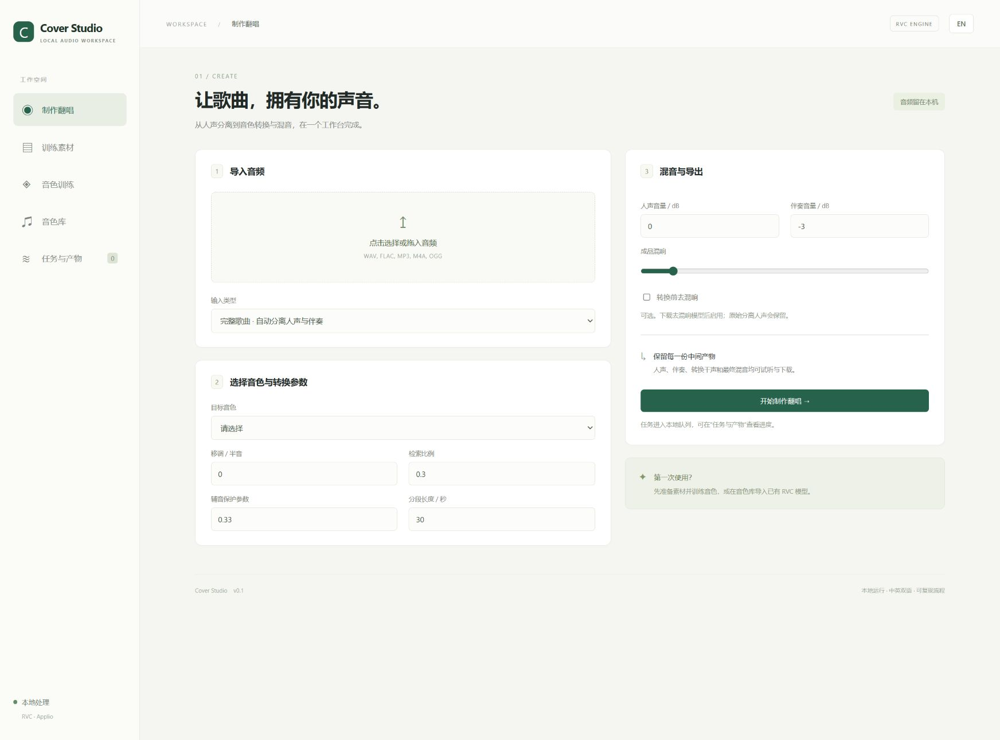

# Cover Studio

[English](README.en.md) · 简体中文

本地运行的中英双语 AI 翻唱工作台，以 RVC / Applio 为 A 引擎，优先面向中文歌声。默认中文，右上角可以切换英文，浏览器记住语言选择。



**v0.2.0：专业模式、训练曲线与实时控制台。** 右上角开启“专业模式”，进入“训练监控”选择任务。参见 [更新日志](CHANGELOG.md)。已有 Git 安装可关闭工作台后运行 `update.bat`，再运行 `start.bat`。

## 当前包含

- 素材上传、人声与伴奏分离、可选去混响、切片、安静/削波片段标记与人工筛选。
- RVC 预处理、RMVPE 音高提取、ContentVec 特征提取、模型训练与检索索引的任务编排。
- 已有 `.pth` / `.index` 音色导入、音色包 ZIP 导出。
- 整曲或已有干声转换、移调、检索比例、辅音保护、分段与交叉淡化。
- 人声/伴奏音量、简易混响、防削波混音、24-bit WAV 及中间文件下载。
- 本地持久任务、引擎日志、停止与同参数重试、完成阶段缓存、重启后手动恢复。
- 专业模式中的真实 TensorBoard 曲线（损失、梯度、学习率）、平滑与采样值查看、轮数/步数/进度，以及实时增量控制台。没有真实指标时显示空状态；控制台仅查看输出，不执行命令。

专业模式每 2 秒读取一次所选任务。暂停跟随只影响日志显示，不暂停训练；清空视图不会删除日志。控制台只保留最近 200,000 字符，完整日志可下载。曲线最多显示每项 1,000 个保留点，超长运行采用有界采样并提示；历史事件文件保留在本地。

**验证边界：按用户要求，尚未执行个人音色训练或真实歌曲翻唱。** 自动测试使用合成信号及替身转换器，验证数据流程和拼接，不代表音质验收。最新本机结果见 [实施记录](docs/IMPLEMENTATION_STATUS.md)。

## 安装与启动（Windows）

要求：Python 3.12（`py -3.12` 可用）、Git、NVIDIA 显卡和兼容驱动。首次安装和模型下载需要联网，预留约 20–30 GB 空间。其他平台尚未验证。

1. 克隆此仓库，进入项目目录。
2. 双击 `install.bat`，安装三个独立环境、固定版本的 Applio 源码及基础 RVC 权重。
3. 双击 `start.bat`，打开 `http://127.0.0.1:7860`。

仅安装界面或分组件安装：

```powershell
powershell -NoProfile -ExecutionPolicy Bypass -File scripts/setup.ps1
powershell -NoProfile -ExecutionPolicy Bypass -File scripts/setup.ps1 -Engine
powershell -NoProfile -ExecutionPolicy Bypass -File scripts/setup.ps1 -Separator
powershell -NoProfile -ExecutionPolicy Bypass -File scripts/setup.ps1 -Models
```

`-All` 安装所有组件。只运行环境检查，不训练：

```powershell
.venv/Scripts/python scripts/doctor.py
```

界面与队列使用 `.venv`，RVC 使用 `.venv-rvc`，分离使用 `.venv-separator`。后两者预先安装 PyTorch 2.11.0 / CUDA 13.0 wheel，避免默认 CPU wheel 或不同引擎的依赖相互覆盖。环境检查会验证 CUDA 矩阵运算、引擎导入和上游 commit，报告保存在 `data/diagnostics.json`。

## 使用顺序

1. 在“训练素材”上传目标音色录音。优先干净歌声；有伴奏时勾选人声分离。去混响和 60 Hz 高通按需要启用。
2. 等待素材处理完成，回到“训练素材”展开片段列表，试听并剔除不合格片段，点击“保存片段选择”。过低音量片段默认不选。
3. 在“音色训练”选择素材集、轮数、批大小等，主动点击开始后才训练。任务将依次预处理、提取特征、下载/校验对应预训练权重、训练和建索引。
4. 训练结束自动登记最新导出权重到音色库。每次保存的推理检查点也出现在任务产物里，可以下载后重新导入并试听选择。
5. 在“制作翻唱”上传歌曲并选择音色。已有干声可以跳过分离，并另传伴奏。完成后到“任务与产物”试听或下载文件。

已有音色时可直接在“音色库”导入 `.pth` 和可选 `.index`，跳过训练。音色包可导出为 ZIP；导入到另一台机器时，解压后分别导入模型和索引。

完整歌曲默认使用 BS-RoFormer；去混响使用 `MDX23C-De-Reverb-aufr33-jarredou.ckpt`。分离权重首次使用由 audio-separator 下载到 `models/separation/`。它们的校验及版本策略由该组件管理；本项目基础 RVC 权重则在 `configs/models.json` 固定 Hugging Face revision 与 SHA-256。**首次下载完成前不算完整离线可用。**

## 重试与停止

- 单服务、单 worker、单卡密集任务串行执行。不要以多个服务进程共享同一个 `data/`。
- 重试复用任务原参数和训练素材快照，校验已完成阶段产物后跳过它们。
- 训练恢复加载上游已保存的 G/D 状态；没有已保存检查点时从头开始。停止为进程树终止，最近一次保存后的训练进度会丢失。
- 改批大小、轮数等参数时创建新任务。当前界面不提供原任务参数编辑。
- 关闭服务后，未完成任务标为“服务中断”；重启后手动点击恢复，避免意外启动训练。

## 文件与发布

```text
studio/                 API、持久队列、音频处理和双语界面
scripts/                安装、启动、环境诊断与独立引擎 worker
configs/                上游 commit、默认参数和基础权重清单
tests/                  合成音频、API、恢复、取消与拼接验证
docs/                   实施记录、截图和 B 引擎交接
vendor/Applio/          安装时克隆，Git 忽略
data/                   上传、素材、音色、训练检查点与任务产物，Git 忽略
models/                 分离权重，Git 忽略
```

代码和文档可以提交 Git；虚拟环境、上游 checkout、模型、录音、输出及本地配置已排除。项目不包含预训练权重和第三方完整源码。GitHub 仓库：https://github.com/reaiksp/FCA-FORGE- 。安装器按 `configs/upstream.json` 重建上游依赖。

仅绑定本机回环地址。模型导入不执行反序列化；首次转换时由上游引擎加载，建议使用可信来源模型。使用有权处理的录音与素材。

## 开发与 B 引擎

```powershell
.venv/Scripts/python -m pytest -q
node --test tests/frontend.test.mjs
.venv/Scripts/python -m uvicorn studio.app:app --host 127.0.0.1 --port 7860
```

应用 API 文档：`http://127.0.0.1:7860/docs`。API 的文件引用均相对于 `data/`，不接受任意本机路径。测试使用独立临时目录，不启动神经网络训练。

B（Seed-VC）尚未实现，交接设计位于 [B 架构文档](docs/SEED_VC_B_ARCHITECTURE_HANDOFF.md)。A 的引擎边界在 `studio/engines.py`，共享步骤在 `studio/pipeline.py`。B 应新增适配器和独立环境，沿用现有任务、素材、产物及语言系统。

许可证及出处见 [第三方说明](THIRD_PARTY_NOTICES.md)。

## AI 协作署名

本项目由 reaiksp 发起并维护，OpenAI Codex 协助完成方案设计、A 引擎工作台代码、测试和文档。此署名记录 AI 的协作贡献，不代表 OpenAI 官方项目或背书；项目验证范围见 [实施记录](docs/IMPLEMENTATION_STATUS.md)。
